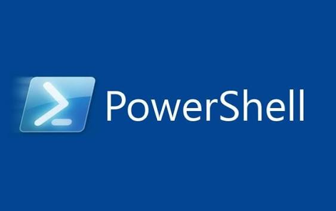

## Phân tích và so sánh PowerShell và Gitbash
#### Khái niệm 
- **PowerShell**:  Là một framework quản trị hệ thống và tự động hóa mạnh mẽ do Microsoft phát triển, tích hợp sâu với .NET và hệ điều hành Windows (phiên bản hiện đại PowerShell 7+ đã hỗ trợ đa nền tảng trên cả Linux và macOS).
- **Gitbash**: Là một ứng dụng cung cấp lớp tương thích (emulation) môi trường dòng lệnh Bash (Bourne Again SHell) của Unix/Linux trên Windows. Nó thường được cài đặt kèm theo phần mềm quản lý mã nguồn Git (Git for Windows), đi kèm các tiện ích Unix kinh điển (grep, awk, sed, ssh...).
  #### Bảng so sánh
| Tiêu chí | PowerShell | GitBash |
| :--- | :---: | ---: |
| bản chất kỹ thuật | Shell hướng đối tượng (Object-oriented).|Shell hướng văn bản thuần túy (Text-based / Stream of bytes).|
|Dữ liệu truyền qua Pipeline |Truyền các đối tượng (.NET Objects) kèm thuộc tính và phương thức.|Truyền các chuỗi văn bản thô (Plain text strings).|
|Cú pháp lệnh| Theo chuẩn Verb-Noun (Động từ - Danh từ), ví dụ: Get-Process, Stop-Service.|Theo lệnh Unix truyền thống ngắn gọn, ví dụ: ls, grep, cat, rm.|
|Hệ điều hành tối ưu|Windows (Quản trị hệ thống, Active Directory, Azure, M365).|Unix-like / Linux / macOS (và dùng trên Windows khi cần thói quen Linux).|
|Khả năng tương tác hệ thống|Truy cập sâu vào Windows Registry, WMI, dịch vụ hệ thống và .NET.|Không truy cập trực tiếp vào Windows Registry hay các dịch vụ nội bộ của Windows.|
|Hỗ trợ Git|Có thể dùng lệnh Git, nhưng không tối ưu bằng môi trường Bash gốc.|Tích hợp sẵn và tối ưu rất tốt cho các lệnh Git, kho lưu trữ (repository).|
#### Điểm mạnh điểm yếu 

- ***Điểm mạnh***
- **Xử lý cấu trúc cực tốt**: Vì truyền đối tượng thay vì chuỗi, bạn có thể lọc (Where-Object), sắp xếp (Sort-Object) các thuộc tính của kết quả mà không cần cắt chuỗi phức tạp bằng regex.
- **Tự động hóa Windows & Cloud**: Là công cụ không thể thiếu khi quản trị máy chủ Windows, Azure, hay Microsoft 365.
- 